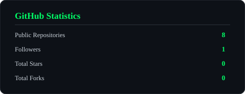
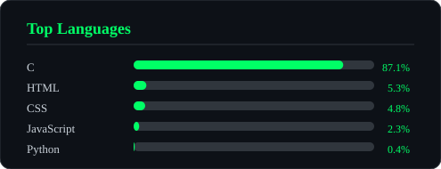

# 🛡️ BADHON MONDOL | CYBER SECURITY

<p align="center">
  
</p>

<p align="center">
  
</p>

<p align="center">
  
  
  
</p>

---

## 💀 SYSTEM TERMINAL

```bash
┌──(badhon㉿kali)-[~]
└─$ whoami

Badhon Mondol

┌──(badhon㉿kali)-[~]
└─$ cat identity.txt

Name       : Badhon Mondol
Role       : Cyber Security Student
University : UFTB
Interest   : Ethical Hacking
Focus      : Security Research
Mindset    : Think Like An Attacker

┌──(badhon㉿kali)-[~]
└─$ echo "Welcome to my profile!"
```

## 👨‍💻 ABOUT ME

Hi! I'm **Badhon Mondol**, a Cyber Security Engineering student passionate about cybersecurity, ethical hacking, and digital security research.

- 🎓 Cyber Security Engineering Student at UFTB.
- 🔐 Interested in Ethical Hacking & Penetration Testing.
- 🦠 Exploring Malware Analysis.
- 🌐 Learning Network & Web Application Security.
- 🔍 Interested in OSINT & Digital Forensics.
- 🐧 Exploring Linux and Kali Linux.
- 🐍 Learning Python for Security Automation.
- 💻 Studying C Programming and System Fundamentals.

> "Think like an attacker. Build like an engineer. Defend like a professional."

---

## ⚡ CURRENT MISSION

<p align="center">
  
</p>

| Security Domain | Focus |
|---|---|
| 🔐 Ethical Hacking | Reconnaissance, Enumeration |
| 🌐 Network Security | TCP/IP, DNS, HTTP/HTTPS |
| 🛡️ Web Security | OWASP Top 10, Burp Suite |
| 🦠 Malware Analysis | Static & Dynamic Analysis |
| 🔎 OSINT | Open Source Intelligence |
| 🕵️ Digital Forensics | Investigation & Evidence |
| 🐧 Linux | Kali Linux, Administration |
| 📡 Network Analysis | Wireshark, Nmap |

---

## 🧰 SECURITY ARSENAL

### 💻 Operating Systems

<p align="center">
  
</p>

### 👨‍💻 Programming & Scripting

<p align="center">
  
</p>

### 🔧 Tools & Platforms

<p align="center">
  
</p>

### 🔥 Cybersecurity Tools

<p align="center">
  
  
  
  
  
  
</p>

---

## 🧬 SECURITY DOMAINS

<p align="center">
  
  
  
</p>

<p align="center">
  
  
  
</p>

---

## 📊 GITHUB STATISTICS

<p align="center">
  
  
</p>


---


---

## 🐍 MATRIX CONTRIBUTION SNAKE

<p align="center">
  
</p>

---

## 🌐 CONNECT WITH ME

<p align="center">
  <a href="https://github.com/badhon220">
    
  </a>
  <a href="https://linkedin.com/in/badhonmondol">
    
  </a>
  <a href="mailto:physics1233217001@gmail.com">
    
  </a>
</p>

---

<p align="center">
  
</p>

<p align="center">
  
</p>

<p align="center">
  <b>⚡ STAY CURIOUS • KEEP LEARNING • KEEP SECURING ⚡</b>
</p>
